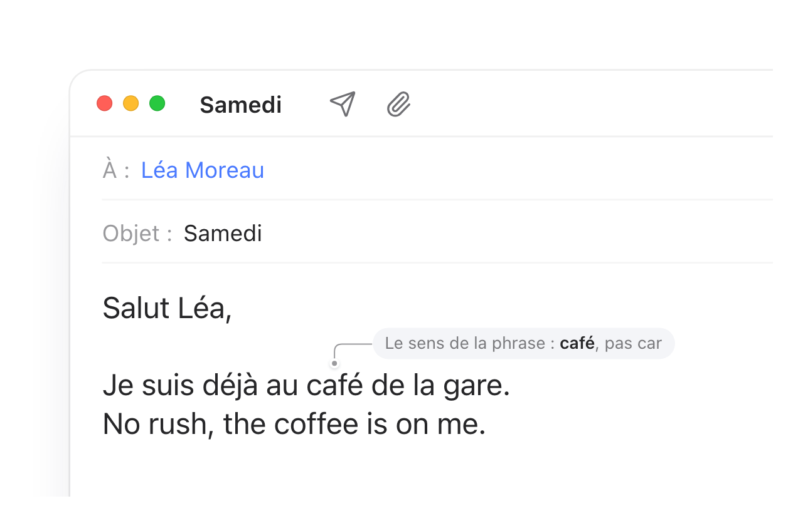

# Retouche

Correction automatique façon iPhone pour tout le Mac. Retouche vit dans la barre des menus, corrige les fautes de frappe dans toutes les apps au moment où vous tapez espace, et reconnaît à chaque phrase si vous écrivez en français ou en anglais.



- `continure` → `continuer`, `etre` → `être`, `jai` → `j'ai`, `parceque` → `parce que`
- `dexemples` → `d'exemples`, `dun` → `d'un`, `il ya` / `n'ya` → `il y a` / `n'y a`
- `teh` → `the`, `definately` → `definitely`, `adress` → `address`, `alot` → `a lot`
- Avec Apple Intelligence, le sens de la phrase départage les corrections proches : « Je bois un cafr » → `café` et pas `car`, « Je prends le trein » → `train` et pas `frein`.
- Ne touche jamais à un mot qui existe dans l'une de vos langues, aux noms propres, sigles, URLs, e-mails, chiffres ni à l'argot (`mdr`, `jsp`, `ya`, `btw`…).
- Trois forces de correction : prudente, équilibrée (par défaut) ou audacieuse.
- ⌫ juste après une correction l'annule, et le mot n'est plus jamais corrigé.
- Les lettres du mot se soulèvent, se remettent dans l'ordre et retombent sur le mot corrigé, en moins d'une seconde.

## Installer

1. Téléchargez [**Retouche.dmg**](https://github.com/cussac97/retouche/releases/latest/download/Retouche.dmg) (macOS 14 ou plus récent, Mac Apple silicon ou Intel), ouvrez-le et glissez Retouche dans Applications.
2. Retouche n'est pas encore signé par un compte développeur Apple, donc macOS refuse de l'ouvrir la première fois. Ouvrez **Réglages Système › Confidentialité et sécurité**, descendez jusqu'au message sur Retouche et cliquez sur **Ouvrir quand même**.
3. Autorisez Retouche dans **Réglages Système › Confidentialité et sécurité › Accessibilité** : c'est ce qui lui permet de voir la frappe et de corriger le mot. Après une mise à jour, macOS peut redemander cette autorisation ; si Retouche est coché mais demande toujours l'accès, cliquez sur **Réinitialiser l'autorisation** dans son menu.

Apple Intelligence départage les corrections ambiguës sur macOS 26 ou plus récent, quand elle est activée sur le Mac.

## Comment ça marche

```
Touches ──► Event tap (thread dédié) ──► TypingSession ──► CorrectionEngine ──► backspaces + texte
               │                         (buffer, undo,     │
               │                          corrections        ├─ NSSpellChecker : moteur d'autocorrection d'Apple
               │                          différées)         ├─ NaturalLanguage : langue de la phrase
               │                                             ├─ TypoMetric : distance de frappe (AZERTY/QWERTY)
               └─ Accessibilité : texte avant le curseur      └─ Apple Intelligence : cas ambigus (Xcode 26+)
                  et position du mot pour la bulle
```

- **Moteur d'Apple, garde-fous à nous.** Les candidats viennent du correcteur système de macOS (le même que TextEdit, Mail et Notes, avec votre dictionnaire personnel). Retouche ajoute une distance de frappe pondérée : lettres inversées, accents oubliés, touches voisines sur votre clavier réel. Une correction n'est appliquée que si elle s'explique par une faute de frappe.
- **Bilingue par phrase.** La langue est estimée à partir de NaturalLanguage, d'un vote des dictionnaires et de la phrase précédente. Un mot qui existe dans une autre de vos langues n'est corrigé que si la seule différence est un accent ou une apostrophe (`deja` → `déjà` dans une phrase clairement française), ou une simple inversion de lettres dans une longue phrase sans ambiguïté.
- **Aucun ralentissement.** Le mot est évalué pendant que vous le tapez. Quand vous appuyez sur espace, la réponse est presque toujours prête. Sinon, la correction arrive un instant plus tard, sans jamais bloquer la frappe.
- **Rien ne sort du Mac.** Pas de réseau, pas de journal de frappe.

## Compiler

Prérequis : macOS 14 ou plus récent, Xcode 16 ou plus récent (Xcode 26 ou plus récent pour Apple Intelligence).

```bash
make run
```

Au premier lancement, autorisez Retouche dans **Réglages Système › Confidentialité et sécurité › Accessibilité**. Les builds Debug sont signés « ad hoc » avec une exigence de signature fondée sur l'identifiant de l'app (`Config/Debug.req`) : l'autorisation survit donc aux recompilations.

Si Retouche est coché dans la liste mais que l'app demande toujours l'autorisation, macOS a gardé l'entrée d'un ancien build. Cliquez sur **Réinitialiser l'autorisation** dans le menu de Retouche, puis cochez l'app à nouveau.

Ouvrez `Retouche.xcodeproj` dans Xcode pour développer.

```bash
make test       # tests unitaires du moteur
make eval       # tape ~140 phrases FR/EN à travers le vrai moteur : précision et latence (STRENGTH=bold…, IA=1)
make snapshots  # rendu PNG du menu, de la bulle, de l'icône de barre des menus et des réglages
make dmg        # build Release universel dans build/Retouche.dmg, le fichier joint à chaque release
make site       # page de présentation et démo animée, sur http://127.0.0.1:5180 (Node 18+)
```

## Apple Intelligence

L'orthographe seule ne départage pas toujours : `cafr` est à une touche de `car` comme de `café`. Quand plusieurs corrections sont presque aussi plausibles, Retouche demande au modèle de langage d'Apple Intelligence, intégré au Mac (framework `FoundationModels`), lequel a du sens dans la phrase (`Packages/RetoucheKit/Sources/RetoucheKit/ContextArbiter.swift`).

- Le modèle ne peut répondre que par l'un des mots proposés : sa réponse est contrainte à la liste.
- Il penche vers le premier mot de la liste. La question lui est donc posée de deux façons (« quel mot était voulu ? » et « quel mot complète la phrase ? »), et il ne remplace le choix de Retouche que si les deux réponses concordent.
- Une session réutilisée, dont l'échange est effacé après chaque mot, répond en ~0,3 s sur un M2 ; les deux questions prennent ~0,65 s. La correction arrive pendant que vous tapez le mot suivant. Sans réponse après 1,5 s, le choix de Retouche s'applique.
- Seulement pour ces cas serrés (environ une phrase sur dix du banc d'essai). Un mot qui existe dans une autre de vos langues n'est jamais soumis au modèle, sauf pour un accent ou deux lettres inversées.

Sur le banc d'essai, le modèle fait passer les fautes où le sens tranche de 27/30 à 30/30, sans aucune fausse correction. Ce code n'est compilé qu'avec Xcode 26 ou plus récent (SDK macOS 26). Avec un Xcode plus ancien, il est exclu et l'onglet Intelligence l'indique.

## Correction automatique de macOS

Si « Corriger l'orthographe automatiquement » est activé dans Réglages Système › Clavier › Saisie de texte, macOS corrige aussi les mots dans les apps natives. Retouche continue de fonctionner, mais n'applique alors que les corrections instantanées. Pour lui laisser la main partout, désactivez l'option de macOS.

## Structure

- `Retouche/` : l'app (SwiftUI + AppKit) : barre des menus, réglages, bulle, event tap, Accessibilité.
- `Packages/RetoucheKit/` : moteur testable sans interface : `CorrectionEngine`, `TypingSession`, `LanguageDetector`, `TypoMetric`.
- `Site/` : page de présentation (Vite + React). La démo `Site/src/hero/` rejoue la vraie animation de l'app (`morph.ts` est un portage de `LetterMorph.swift`) avec le kit [Stageshow](https://github.com/benjitaylor/skills) (`Site/src/kit/`, licence MIT).
